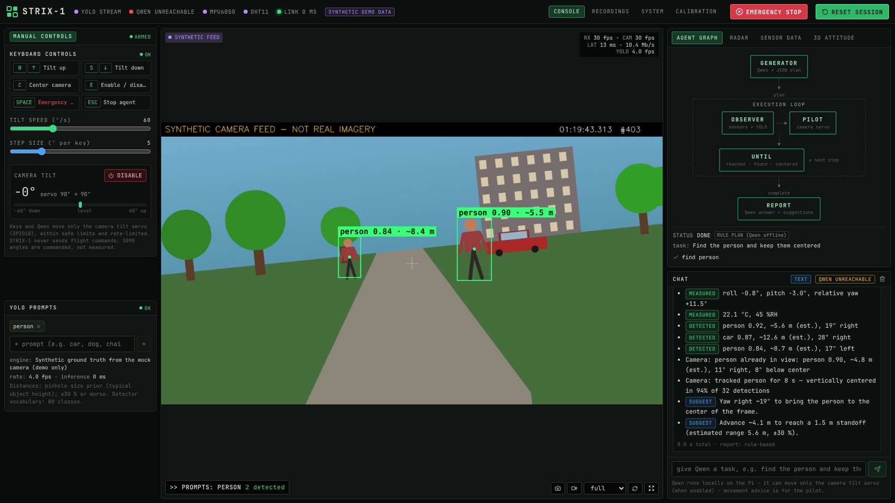

# STRIX-1 — AI camera operator for a Raspberry Pi 5 drone

STRIX-1 turns a **Raspberry Pi 5** on a 250 mm FPV quadcopter (SpeedyFPV ZMR250) into an AI camera
operator. A **local Qwen model** sees through **YOLO**, reads the **MPU6050** (motion) and **DHT11**
(temperature/humidity), **aims the camera with a servo**, **estimates distances** to what it sees
and **suggests how to move** to complete a task. You watch and talk to it from any browser on the
same Wi-Fi; no VNC or monitor needed.

> **Judges:** start with **[docs/JUDGES.md](docs/JUDGES.md)** for a 3-minute demo script.



> **Safety scope.** The AI controls **only the one-axis camera tilt servo**, and only after the
> operator enables it (E key), within safe limits and a slew rate. EMERGENCY STOP (Space) disables
> it instantly. STRIX-1 never sends motor, flight-controller or navigation commands. Movement
> advice is for the human pilot.

## How it works

```
                 ┌──────────────── Raspberry Pi 5 ────────────────────────────────────────┐
 Camera Module 3 ─▶ Picamera2 ─┬─▶ MJPEG stream ─────────────────────────────────────────┐ │
                               └─▶ YOLO (ONNX) ─▶ objects + distance + bearing ─┐       │ │
 MPU6050 ─▶ complementary filter ─▶ roll / pitch / yaw ──────────────────────────┤       │ │
 DHT11   ─▶ kernel IIO driver ────▶ temperature / humidity ──────────────────────┤       │ │
                                                                                  ▼       │ │
          Qwen (llama.cpp, local)  GENERATOR ─plan─▶ OBSERVER → PILOT → UNTIL ─▶ REPORT  │ │
                                                       │ (camera servo only)              │ │
 SG90 tilt servo ◀──────── ServoService (limits, slew, enable, e-stop) ◀──────┘          │ │
                 └────────────────────── FastAPI :8000 (REST + WebSocket) ───────────────┘─┘
                                                │ Wi-Fi
                                   Browser console (laptop / phone)
```

| Feature | Details |
|---|---|
| **Qwen agent** | Plans with schema-constrained JSON (always valid, even for a 1.5–3 B model), then runs camera skills: `look`, `tilt`, `center`, `scan`, `find`, `track`, `wait`. It reports with `[MEASURED]` / `[DETECTED]` / `SUGGEST:` tags. If Qwen is offline, a labeled keyword planner and rule-based report stand in. → [docs/AI.md](docs/AI.md) |
| **YOLO stream** | ONNX detector (YOLOX-S by default, YOLO11n/YOLOv8 supported) running continuously. Green boxes on the video show `person 0.88 · ~5.4 m`. Prompts choose the classes (COCO-80). |
| **Distance & direction** | Pinhole model with typical object heights (HFOV 102°), labeled as estimates (±30 %). Bearing comes from image position; the radar shows a top-down view. |
| **Suggestions** | Computed from geometry and sensors, e.g. "Yaw right ~15°", "Advance ~3.9 m to a 1.5 m standoff", "Level the airframe first". |
| **Sensors** | MPU6050 at 100 Hz with a complementary filter (roll/pitch, *relative* yaw: no magnetometer), calibration and health checks. DHT11 through the Pi 5 kernel driver. |
| **Manual control** | Keyboard: E enable, W/S or ↑/↓ tilt, C center, Space emergency stop, Esc stop agent. Speed and step sliders. |
| **Console UI** | One screen: controls · live video · agent graph / radar / sensor data / 3D attitude · chat. Secondary views: recordings (SQLite sessions, playback, CSV/JSON), system health, calibration. |
| **Demo mode** | `STRIX_MOCK=true` gives a synthetic camera scene, IMU and DHT with ground-truth detections, all labeled **SYNTHETIC**. A missing real device shows *disconnected*, never fake data. |

## Quick start (no hardware, any laptop)

```bash
git clone https://github.com/Nesi56/STRIX-1.git && cd STRIX-1
cd frontend && npm ci && npm run build && cd ..        # Node ≥ 20.19
scripts/run_mock.sh                                     # prints the access token
```

Open <http://localhost:8000>, sign in with the token, press **E**, then ask the chat:
*"Find the person and keep them centered"*.

## On the Raspberry Pi 5

Full guide: **[docs/SETUP_PI.md](docs/SETUP_PI.md)** · wiring: **[docs/HARDWARE.md](docs/HARDWARE.md)**.

```bash
git clone https://github.com/Nesi56/STRIX-1.git ~/STRIX-1 && cd ~/STRIX-1
scripts/install_pi.sh                                    # packages, venv, .env + token, dashboard build
scripts/install_pi.sh --skip-apt --skip-frontend --configure-boot --groups && sudo reboot
scripts/get_detector_model.sh                            # YOLOX-S detector (checksum-verified)
scripts/build_llama_cpp.sh && scripts/download_qwen.sh   # local Qwen
scripts/install_llama_service.sh ~/STRIX-1/models/qwen2.5-3b-instruct-q4_k_m.gguf 3 4096
scripts/verify_all.sh                                    # IMU, DHT11, camera, power checks
scripts/install_pi.sh --skip-apt --skip-frontend --systemd   # autostart
```

Then browse to **`http://<hostname>.local:8000`** from your laptop. Everything also works over SSH;
see SETUP_PI.md.

## Wiring summary (BCM numbering in code)

| Device | Signal | Pi physical pin | BCM |
|---|---|---|---|
| MPU6050 | VIN (3.3 V) / GND / SDA / SCL | 1 / 6 / 3 / 5 | — / — / GPIO2 / GPIO3 |
| DHT11 | VCC (3.3 V) / DATA / GND | 17 / 7 / 9 | — / GPIO4 / — |
| SG90 | Signal | 12 | GPIO18 |
| SG90 | +5 V / GND | **external regulated 5 V** / common ground | — |
| Camera Module 3 Wide | CSI ribbon | CAM/DISP connector | — |

Never power the servo from a GPIO pin. Check the 52Pi PD board's 5 V rating before powering the servo from it.

## Project structure

```
backend/app/services/  agent_service (Qwen agent) · ai_context (grounding, suggestions, prompts) · ai_qwen_service
                       detector_service + detector (YOLO/YOLOX/HOG, distance) · camera_service · imu_service
                       dht_service · servo_service · telemetry_service · recording_service · system_monitor
                       mapping_service (localization status, experimental VO) · container
backend/app/api/       api.py (REST) · websocket.py · auth.py · network_guard.py
backend/tests/         pytest suite (demo mode, simulated llama-server)
frontend/src/          console UI: components/console/* (TopBar, ManualControls, PromptsPanel, VideoFeed,
                       AgentGraph, RadarView, SensorData, ChatPanel), React Three Fiber 3D, Recharts
scripts/               install, run, verification, detector model, llama.cpp/Qwen helpers
config/ docs/          systemd units, boot overlay block · setup, hardware, AI, API, judge guide
```

## Testing

```bash
scripts/run_tests.sh      # backend pytest + frontend typecheck, vitest, production build
```

The tests cover:
- agent planning, validation, servo skills, tracking, emergency stop and the offline fallback (simulated llama-server)
- YOLOv8/YOLOX decoding, NMS, distance geometry and prompts
- sensor parsing, orientation filter, calibration and servo limits
- auth, WebSocket and REST validation
- recording/export, the MJPEG parser and clock sync

## Verified vs. unverified

Built and tested without the physical drone (x86-64 Linux, demo mode, headless browser). Verified:
- the full console
- the agent (keyword planner, plus Qwen protocol against a simulated llama-server)
- tracking in the synthetic scene
- **the YOLOX-S model on a real photo** (person 0.93)
- auth and recording

**Needs validation on the Pi** ([docs/HARDWARE_VERIFICATION.md](docs/HARDWARE_VERIFICATION.md)):
- real sensor/servo/camera I/O
- detector FPS on the Pi 5 CPU
- Qwen speed and plan quality
- the YOLO11n export path
- the servo tilt direction (`STRIX_SERVO_UP_IS_POSITIVE`)
- the 52Pi board's servo power capacity

## Documentation

[JUDGES](docs/JUDGES.md) · [SETUP_PI](docs/SETUP_PI.md) · [HARDWARE](docs/HARDWARE.md) · [AI](docs/AI.md) ·
[STREAMING](docs/STREAMING.md) · [API](docs/API.md) · [ARCHITECTURE](docs/ARCHITECTURE.md) ·
[TROUBLESHOOTING](docs/TROUBLESHOOTING.md) · [HARDWARE_VERIFICATION](docs/HARDWARE_VERIFICATION.md)

## License

MIT — see [LICENSE](LICENSE). Optional models have their own licenses: YOLOX-S (Apache-2.0),
Ultralytics YOLO11 (AGPL-3.0), Qwen2.5-1.5B (Apache-2.0), Qwen2.5-3B (Qwen Research License — check its terms
for your use). Always confirm on the model card.
