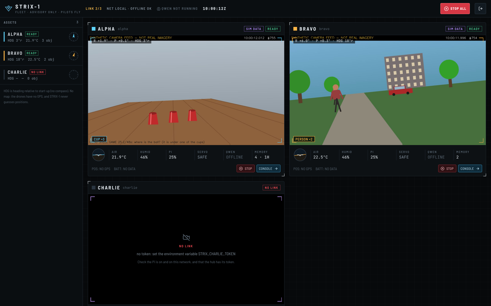
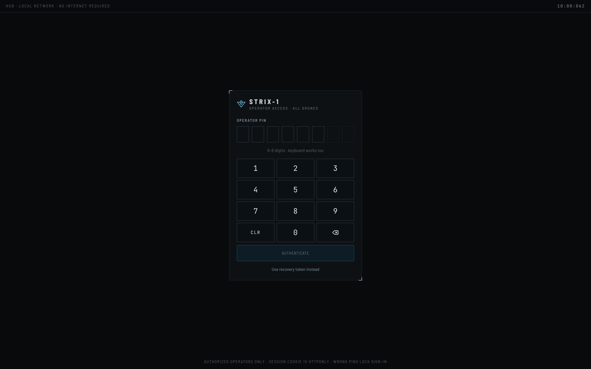

# STRIX-1 Hub: several drones, one self-hosted dashboard



The hub is a small Rust program (`hub/`) that runs on the laptop you bring to the field. It shows every
STRIX-1 drone on one screen (live camera, attitude, temperature, servo, what each one sees and remembers)
and opens any drone's full console with one click. It is **advisory only**, like the rest of STRIX-1: it
forwards the drones' existing commands (camera servo, memory, chat) and never sends flight, motor or
navigation commands. Each pilot flies their own drone.

```
 browser ──► hub (laptop, Rust) ──► drone Alpha (Pi 5, STRIX-1 service)
   │            │  one telemetry WebSocket per drone      ├─ camera, YOLO, memory
   │            │  /d/<id>/api/... forwarded with that     ├─ MPU6050, DHT11
   │            │  drone's token (browser never sees it)   └─ SG90 camera servo
   │            └─ optional: shared Qwen (llama-server) ◄── drones send chat/vision requests
   └─ fleet view (#/)  ·  one drone's console (#/d/<id>)
```

## Run it

You need Rust ([rustup.rs](https://rustup.rs)) and Node 20+ on the laptop.

```bash
cd frontend && npm ci && npm run build && cd ..
```

```bash
cd hub && cp hub.example.toml hub.toml
```

Edit `hub.toml`: one `[[drone]]` block per Pi, with its address. Give the hub each drone's
`STRIX_AUTH_TOKEN` through an environment variable (never write tokens in `hub.toml`):

```bash
export STRIX_ALPHA_TOKEN='<alpha token>' STRIX_BRAVO_TOKEN='<bravo token>'
```

```bash
cargo run --release -- hub.toml
```

Open http://127.0.0.1:9000 and sign in with the hub token:

```bash
./target/release/strix-hub token hub.toml
```

### Sign in with an operator PIN



Set a short PIN on the hub computer (never through the web page):

```bash
./target/release/strix-hub set-pin hub.toml
```

Restart the hub; the sign-in page then shows a PIN pad (the keyboard works too). The PIN is 6–8 digits
(not all the same, not 123456-style runs), stored only as a salted PBKDF2 hash in `data/hub_pin`. Five wrong
PINs lock sign-in for 1 minute, then 2, 4, 8… up to 15 minutes. The long token still works as a recovery login
("Use recovery token instead"); `strix-hub clear-pin hub.toml` removes the PIN.

Everything works with no internet: fonts and scripts are bundled, and the hub and drones only talk over
your local network.

Shortcuts: **Space** on the fleet view stops every drone's camera servo and AI task; inside a console it
stops that drone (the same keys as before work there).

### Try it without any Pi

Start two demo drones and a hub that points at them:

```bash
STRIX_PORT=8101 STRIX_AUTH_TOKEN=tok1 STRIX_DATA_DIR=data/d1 scripts/run_mock.sh
```

```bash
STRIX_PORT=8102 STRIX_AUTH_TOKEN=tok2 STRIX_DATA_DIR=data/d2 STRIX_MOCK_SCENE=outdoor scripts/run_mock.sh
```

Then use `url = "http://127.0.0.1:8101"` / `8102` in `hub.toml` and `STRIX_ALPHA_TOKEN=tok1 STRIX_BRAVO_TOKEN=tok2`.

## Share one Qwen from the laptop (keeps the Pis cool)

1. On the laptop, run llama.cpp's server on loopback with the same Qwen model files `scripts/setup_ai.sh` uses:
   `llama-server -m <model.gguf> --mmproj <mmproj.gguf> --host 127.0.0.1 --port 8080`
2. Uncomment `[qwen]` in `hub.toml` and restart the hub. Show the key the drones need with
   `strix-hub qwen-key hub.toml`.
3. On each Pi, in `.env`: `QWEN_SERVER_URL=http://<laptop-ip>:9080`, `QWEN_API_KEY=<that key>`,
   `QWEN_MANAGE_SERVER=false`, then restart STRIX-1.

The relay answers only private networks, requires the key, and forwards only `/health`, `/props`,
`/v1/models` and `/v1/chat/completions`. A laptop runs the bigger 3B model comfortably (`setup_ai.sh --best`).

## Security

- The dashboard listens on `127.0.0.1` only. Set `listen = "0.0.0.0:9000"` to let phones on the same Wi-Fi in;
  public IP addresses are still refused unless `allow_public_clients = true`. For remote access use a private
  VPN such as Tailscale (its 100.64.0.0/10 addresses count as private), never port forwarding.
- Hub login is a token exchanged for an HttpOnly, SameSite=Strict cookie, rate-limited to 10 tries a minute.
  The token and Qwen key are generated into `data/` with mode 0600 and never logged.
- Drone tokens stay in the hub. Drone cookies, login and API docs are not reachable through it; `..` and
  encoded slashes are refused; WebSockets must come from the hub's own page.
- Battery appears only when a drone reports a real battery source; nothing is estimated.

## What's next: the Rust drone service

Today each Pi still runs the Python service. The plan moves it to Rust piece by piece, keeping the same
HTTP/WebSocket API so the hub and dashboard don't change:

| Step | Piece | Rust approach |
|---|---|---|
| 1 | Sensors: MPU6050 (100 Hz fusion), DHT11 | `rppal` I2C/GPIO; port the complementary filter and its tests |
| 2 | SG90 camera servo with limits, slew rate, e-stop latch | `rppal` hardware PWM on GPIO18 |
| 3 | Camera + MJPEG | read frames from `rpicam-vid` (libcamera has no mature Rust binding) |
| 4 | YOLO + distance estimates | `ort` (ONNX Runtime) with the same YOLOX-Tiny model |
| 5 | Object memory, agent, recordings | port with the Python tests as the spec |

Qwen stays in llama.cpp; Rust only sends it requests.
