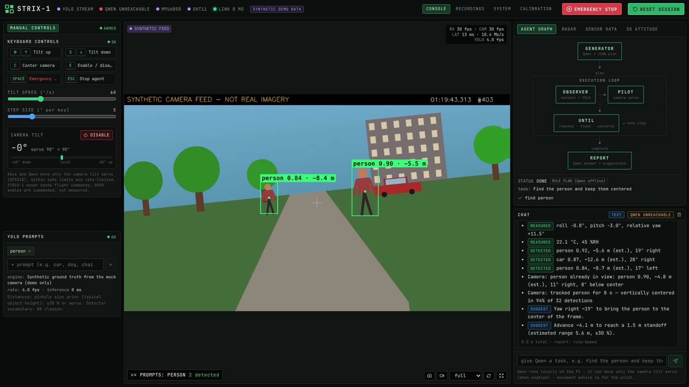

# STRIX-1 — guide for judges

**One sentence:** STRIX-1 turns a Raspberry Pi 5 on a small drone into an AI camera operator. A
local Qwen model sees through YOLO, reads the drone's motion and environment sensors, aims the
camera itself, estimates how far away things are and tells the pilot how to move. Everything runs
on the drone, with no cloud.



## What you are looking at

| Area | What it shows | Try |
|---|---|---|
| **Top bar** | Live status of the YOLO stream, Qwen, MPU6050 (motion), DHT11 (temp/humidity) and the Wi-Fi link (round-trip ms). Red **EMERGENCY STOP**, green **RESET SESSION**. | Press **Space** at any time → servo control disabled and agent cancelled. |
| **Manual controls** (left) | Keyboard control of the camera tilt servo, speed and step sliders, current tilt. | **E** enable · **W/↑** tilt up · **S/↓** tilt down · **C** center |
| **YOLO prompts** (left) | Which object classes are drawn on the video. | Type `car` and press Enter. |
| **Live video** (center) | Camera feed with green boxes: `person 0.88 · ~5.4 m` = class, confidence, estimated distance. `>> PROMPTS:` shows the active classes. Top right: received FPS, capture-to-browser latency, YOLO FPS. | Watch the boxes follow the people. |
| **Agent graph** (right) | Qwen's pipeline: **GENERATOR** (plans) → **OBSERVER → PILOT → UNTIL** (executes) → **REPORT**. The active stage glows green; the plan's steps tick off below. | Run a task and watch it. |
| **Radar** | Top-down view of detected objects at their estimated range and bearing inside the camera's field of view. | |
| **Sensor data** | MPU6050 attitude (roll/pitch/yaw), artificial horizon, roll/pitch chart, DHT11, servo, CPU/temperature/power. | |
| **3D attitude** | 3D model of the 250 mm quadcopter moving with the IMU; the camera tilts with the servo. | Drag to orbit. |
| **Chat** | Give Qwen a task in plain English. | See the demo script below. |

## 3-minute demo script

Works on the real drone or in demo mode (`scripts/run_mock.sh`, clearly marked
**SYNTHETIC DEMO DATA**).

1. **Enable the camera servo**: press **E** (the panel shows *ARMED*). Press **W** twice: the
   camera tilts up 10°, and in demo mode the view and the 3D model follow.
2. **Ask: "Find the person and keep them centered".**
   - GENERATOR → Qwen returns a JSON plan: `find person`, then `track person 8 s`.
   - PILOT/UNTIL → the servo moves until the person is vertically centered (the report states
     the % of frames centered).
   - REPORT → e.g. "[DETECTED] person 0.92, ~5.4 m, 15° right … SUGGEST: Yaw right ~15° … Advance
     ~3.9 m to reach a 1.5 m standoff".
3. **Open RADAR**: the same person appears at ~5 m, 15° right.
4. **Ask: "Scan the area and tell me what you see"**: the camera sweeps its tilt range and lists
   what it saw at each angle.
5. **Press Space (EMERGENCY STOP)** during a task: the run stops immediately and servo control
   is disabled.

## Why it is technically interesting

- **Small model, reliable control.** Qwen's planning is constrained by a JSON schema enforced as a
  grammar in llama.cpp, so the 1.5–3 B model can't produce malformed commands. Fast skills
  (tracking at detector rate) keep motion responsive while the LLM only plans and explains.
- **Honest numbers.** Distances use a stated pinhole model with object-size priors and are always
  labeled as estimates. Suggestions come from geometry, not model guesses. Yaw is shown as
  *relative* because the MPU6050 has no compass. Battery and GPS position are shown as
  unavailable rather than faked. Demo data is labeled SYNTHETIC on every screen.
- **Safety by design.** The AI can move *only* the camera tilt servo, only after the operator
  enables it, within safe limits and a slew rate, and a one-key software emergency stop (Space) disables it instantly.
  Aircraft motion is advice for the human pilot.
- **Edge-only.** Camera, YOLO, sensor fusion and Qwen all run on a Raspberry Pi 5 (16 GB) and are
  viewed from any laptop or phone browser over Wi-Fi.
- **Engineering.** FastAPI backend with one thread per device, WebSocket telemetry at 20 Hz,
  low-latency MJPEG with measured glass-to-browser latency, SQLite recording with playback and
  CSV/JSON export, and 100+ automated tests.

## Hardware

Raspberry Pi 5 (16 GB) · Camera Module 3 Wide on a TowerPro SG90 tilt servo (GPIO18) · MPU6050
IMU (I2C) · DHT11 (GPIO4, kernel driver) · SpeedyFPV ZMR250 frame · USB-C PD power bank.
Wiring: [HARDWARE.md](HARDWARE.md).

## Run it yourself (no hardware needed)

```bash
git clone https://github.com/Nesi56/STRIX-1.git && cd STRIX-1
(cd frontend && npm ci && npm run build)
scripts/run_mock.sh          # prints a login token → open http://localhost:8000
```

Without a Qwen server running, the agent uses its labeled keyword planner, so the whole demo
still works. To include Qwen, see [AI.md](AI.md).
