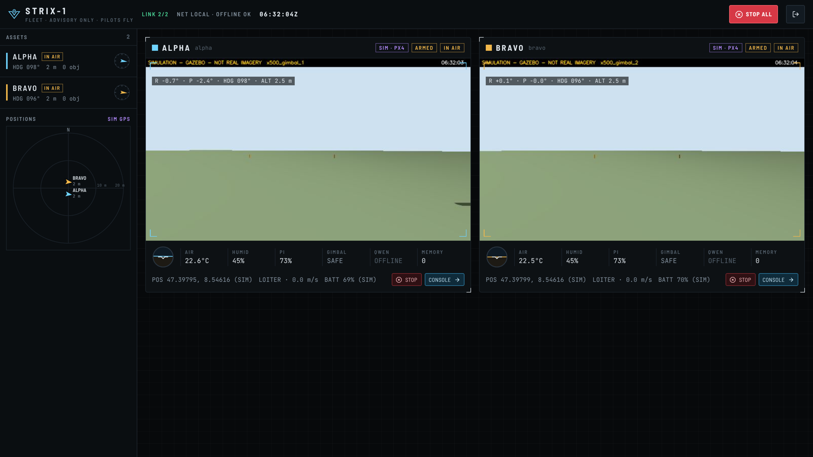

# Simulating a STRIX-1 fleet with PX4 + Gazebo



Test STRIX-1 with several drones before you build them. **PX4** is the real flight-controller software that
flies millions of drones; in SITL mode ("software in the loop") it runs on your computer and flies a drone
inside **Gazebo**, a 3D simulator with physics and cameras. Each simulated drone gets its own STRIX-1 service,
the same code that runs on the Pi, and the hub shows them all together on one screen.

```
 Gazebo world "strix_field" (people, cars, cones)                         your computer
 ├─ drone 1: PX4 SITL #1, x500 quad + camera gimbal ── MAVLink :14541 ──► STRIX-1 #1 :8101 ─┐
 │     its camera ── Gazebo transport ── camera bridge ──────────────────►                  │
 ├─ drone 2: PX4 SITL #2 ─────────────────────────────── MAVLink :14542 ──► STRIX-1 #2 :8102 ─┼─► hub :9100 ─► browser
 └─ drone 3: PX4 SITL #3 ─────────────────────────────── MAVLink :14543 ──► STRIX-1 #3 :8103 ─┘
 QGroundControl ◄── MAVLink :14550 (every drone) ── you fly them
```

## What each part becomes in the simulation

| On the real drone | In the simulation | Label in the dashboard |
|---|---|---|
| Camera Module 3 | The drone's Gazebo camera (1280×720, 115° wide) | "SIMULATED FEED · GAZEBO" + a banner in every frame |
| MPU6050 | PX4's IMU over MAVLink, fed into STRIX-1's own orientation filter | IMU (synthetic) |
| SG90 camera servo | PX4's camera gimbal (MAVLink gimbal protocol v2), held level to the horizon | GIMBAL, with the angle it reports back |
| DHT11 | Demo values (simulators don't model humidity) | synthetic |
| *(none yet)* GPS | PX4's simulated GPS: position, map, "where are we?" | GPS … simulated, SIM GPS |
| *(none yet)* battery | PX4's simulated battery (it drains fast; that is PX4's simulator) | BATTERY … (SIM) |
| *(none yet)* flight state | Armed, flight mode, in air / on ground, speed, heading | FLIGHT row, ARMED / IN AIR badges |
| YOLO, object memory, Qwen | Unchanged, running on the simulated camera | as usual |

## Safety: the simulation keeps the same rule

STRIX-1 never flies the aircraft, in simulation or for real. Its flight-controller link
([`flight_link.py`](../backend/app/services/flight_link.py)) only reads telemetry. The only commands it can send
are camera-gimbal pointing and telemetry-rate requests; arming, take-off, modes, setpoints, waypoints and RC
overrides are blocked before they reach the wire. `tests/test_flight_link.py` checks this with real MAVLink
messages, and `tests/test_safety_static.py` keeps every other file from talking MAVLink at all.
**You** fly the drones, with QGroundControl or PX4's console.

## 1. Set up (once)

Ubuntu 22.04 or 24.04. On Windows 11, use Ubuntu in **WSL2** (Gazebo's window then appears through WSLg).
About 30 minutes and 10 GB of disk:

```bash
scripts/sim/setup_px4_gz.sh
```

It downloads PX4 v1.16.2 into `~/PX4-Autopilot`, installs Gazebo Harmonic with PX4's own installer, builds PX4,
and prepares STRIX-1 (MAVLink support, YOLO model, dashboard, hub). Set `PX4_DIR` to use another folder.

## 2. Start a fleet

```bash
scripts/sim/run_fleet.sh
```

Three drones by default. Options:

| Option | What it does |
|---|---|
| `2` … `8` | number of drones |
| `--headless` | no Gazebo window (watch the cameras in the hub) |
| `--light` | half-size cameras at 10 fps, for computers without a graphics card (see below) |
| `--model x500_mono_cam` | drones with a fixed camera instead of a gimbal |
| `--stop` | stop everything a previous run started |

Open **http://127.0.0.1:9100** and sign in with your hub PIN (the simulated hub shares your real hub's sign-in;
show the token with `hub/target/release/strix-hub token hub/sim.toml`). Logs are in `data/sim/logs/`.

## 3. Fly

The easiest way is **[QGroundControl](https://qgroundcontrol.com)**: it connects to every simulated drone by
itself. Pick a drone at the top, press **Takeoff**, then click the map and **Go to location**.

From a terminal, PX4's own console works too:

```bash
~/PX4-Autopilot/build/px4_sitl_default/bin/px4-commander --instance 1 takeoff
```

```bash
~/PX4-Autopilot/build/px4_sitl_default/bin/px4-commander --instance 1 land
```

PX4 refuses to arm without a ground station ("No connection to the ground control station"), so keep
QGroundControl open even when you use the console.

## 4. Things to try

* Open a drone's console in the hub, press **E** to enable the gimbal and **W/S** to tilt the camera.
* Ask Qwen "where are we?" or "how is the battery?": the answer comes from the flight controller, marked as simulation.
* Fly two drones apart and watch the **Positions** map in the hub; **Stop all** stops every gimbal and AI task.
* Point a drone at the people and cars: YOLO and the object memory work on the simulated camera.

## The world and its objects

`sim/worlds/strix_field.sdf` is a grass field (based on PX4's default world) with orange corner markers.
People, cars and cones are listed in `sim/worlds/strix_field.objects` and added after the world starts. They come
from Gazebo Fuel, so the first run needs internet; after that they are cached in `~/.gz/fuel`. A model that cannot
be downloaded is skipped (see `data/sim/logs/objects.log`); the world never fails because of it. Add your own
objects by adding lines to that file.

## No graphics card? (common on laptops and in WSL)

Gazebo renders every drone's camera. Without a GPU that happens on the CPU and the whole simulation slows down:
in Gazebo's window the "real time factor" drops far below 100 %. Use fewer drones and `--light`:

```bash
scripts/sim/run_fleet.sh 2 --light
```

In testing on a 4-core machine without a GPU, 2 drones went from about 2 % to roughly 60 % of real time with
`--light`.

## The same code works with a real flight controller

If your drone's flight controller runs **PX4, ArduPilot or INAV**, connect one of its telemetry UARTs to the
Pi's UART (GPIO14/15, pins 8 and 10, plus ground) and set in `.env`:

```
STRIX_MAVLINK_URL=/dev/serial0,921600
```

STRIX-1 then shows the real GPS position, battery level, flight mode and heading, read-only. (Enable the UART
with `raspi-config` and turn off the serial console.) **Betaflight** speaks MSP instead of MAVLink, so it isn't
supported yet.

## Troubleshooting

| What you see | What to do |
|---|---|
| Camera: "no Python with Gazebo's bindings" | `sudo apt install python3-gz-transport13 python3-gz-msgs10` |
| Camera: "waiting for the camera of Gazebo model …" | The model has no camera (e.g. plain `x500`); use the default `x500_gimbal` |
| A drone shows NO LINK | Check `data/sim/logs/px4_N.log` and `strix_N.log` |
| Very slow, choppy video | `--light` and fewer drones (see above) |
| People/cars missing | No internet for Gazebo Fuel on the first run (`data/sim/logs/objects.log`) |
| PX4: "Arming denied" | Open QGroundControl; PX4 needs a ground station to arm |

## What was tested

The integration was run end to end with PX4 v1.16.2 and Gazebo Harmonic (gz-sim 8.10) using software rendering:
2 and 3 drones, MAVLink telemetry (IMU, GPS, battery, flight state), the Gazebo camera bridge (1280×720,
115° field of view), gimbal pointing (commanded −30°, PX4 reported −30°), a take-off of two drones from PX4's
console with STRIX-1 following read-only, and the hub's fleet view and map. Not tested there: QGroundControl
itself, Gazebo Fuel downloads (no internet in that environment) and GPU rendering.
